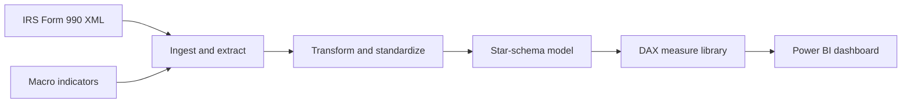

# Nonprofit Fundraising & Economic Intelligence

   

An analytical platform that measures nonprofit fundraising performance and tests it against the national economy. It pulls IRS Form 990 filings and macroeconomic data into one star-schema model, then exposes the result through a four-page Power BI decision-support dashboard. Built independently, on public data.


## Repository map

```
nonprofit-fundraising-intelligence/
├── README.md                        You are here
├── docs/
│   ├── architecture.md              How it is built, and why
│   ├── data-model-and-measures.md   Star schema and the DAX library
│   └── limitations-and-roadmap.md   Honest status and path to production
├── data/                            Public source data (990 filings, economic series)
├── powerbi/                         The Power BI file (.pbix)
└── images/                          Dashboard screenshots
```

## Start here

- [**Architecture**](docs/architecture.md). How the platform is built, stage by stage, and why it is structured that way.
- [**Data model and measures**](docs/data-model-and-measures.md). The star schema and the DAX measure library, grouped by the question each measure answers.
- [**Limitations and roadmap**](docs/limitations-and-roadmap.md). What the prototype does and does not yet do, and how it would reach production.

## Open the dashboard

Download [**the Power BI file**](powerbi/nonprofit-fundraising-intelligence.pbix) and open it in [Power BI Desktop](https://powerbi.microsoft.com/desktop/) (free). GitHub cannot preview a `.pbix` in the browser, so the screenshots in this page show each dashboard page.

## The problem it solves

Fundraising totals on their own do not tell you much. A large contribution number does not tell you whether an organization raises money efficiently or how dependent it is on donations. It says nothing about whether giving keeps pace once inflation is removed, or whether charitable giving tracks the wider economy at all. This platform answers those questions in one place.

## Architecture at a glance



Two sources with different shapes feed one model: semi-structured per-organization XML, and annual economic time series. The real work is building a common framework where the two can be compared on the same terms. Full detail in [architecture](docs/architecture.md).

## The dashboard

**Overview.** Organizational performance at a glance: totals, fundraising efficiency, revenue composition, and geographic distribution (shown at the top).

**Forecasting Fundraising Trends.** Historical giving with a scenario-driven projection a user can steer.


**Economic Context Explorer.** Whether giving actually tracks GDP, income, inflation, and unemployment. What the data shows is that it mostly does not, which is itself the finding.


## Status

A working prototype on a 23-organization sample. It demonstrates the architecture and the analytical approach, not production-grade conclusions. Known data-integrity items and the path to a reproducible platform are documented in [limitations and roadmap](docs/limitations-and-roadmap.md).

## Stack

Power BI, DAX, Power Query, star-schema dimensional modeling, Form 990 XML extraction, public economic data.
