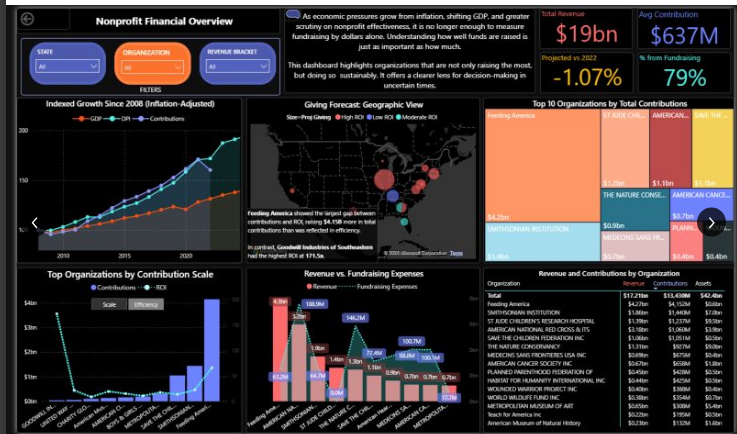
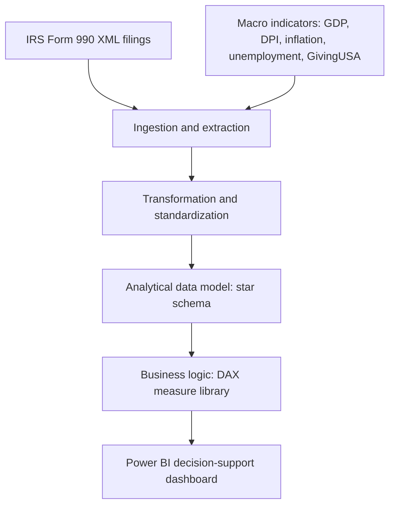
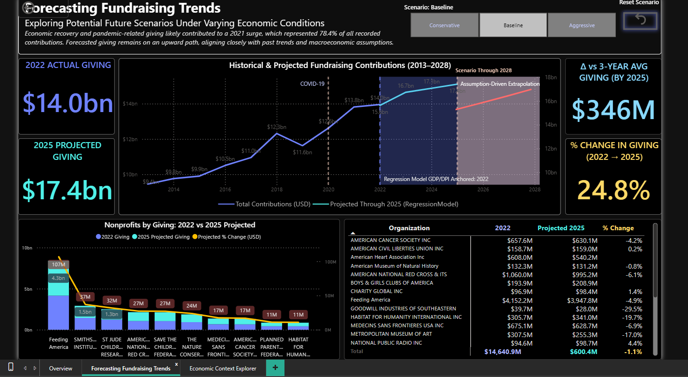
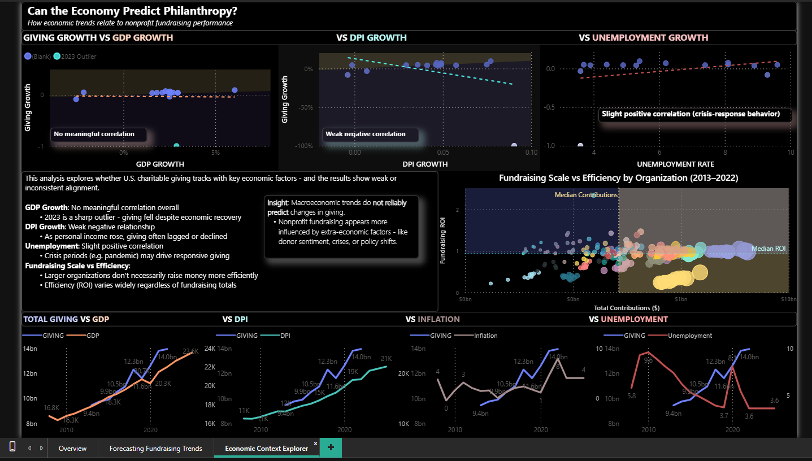

# Nonprofit Fundraising & Economic Intelligence

An analytical platform that evaluates nonprofit fundraising performance and tests it against national economic conditions. It integrates IRS Form 990 filings with macroeconomic data into one model, then exposes the result through an interactive Power BI decision-support dashboard.

I built this independently, on public data. It is a working prototype, not a production system, and the limitations are documented openly further down.

## The problem

Fundraising totals on their own do not tell you much. A large contribution number does not tell you whether an organization raises money efficiently or how dependent it is on donations. It says nothing about whether giving keeps pace once inflation is removed, or whether charitable giving tracks the wider economy at all. This platform was built to answer those questions in one place.

## Architecture

The design separates five concerns, so any stage can change without forcing a rebuild of the others.

Two source systems with different shapes feed one analytical model. Form 990 filings are semi-structured, per-organization XML. The economic indicators are annual time series. The real work is not importing two files. It is building a common framework where the two can be compared on the same terms. The full walkthrough is in [docs/architecture.md](docs/architecture.md).

## Data sources

All public.

- **IRS Form 990 XML filings.** Extracted fields: EIN, tax year, organization name, city and state, NTEE classification, total contributions, program service revenue, total revenue, fundraising expenses, total expenses, net assets.
- **Macroeconomic indicators**, covering 2008 to 2023: Real GDP, Disposable Personal Income, inflation, unemployment, and GivingUSA charitable giving.

## Data model

A star schema built around one organization filing for one tax year. Organizations are keyed on EIN rather than name, because names vary between filings and change over time. A conformed Year dimension aligns tax-year filings with calendar-year economic observations. The full model and the measure library are in [docs/data-model-and-measures.md](docs/data-model-and-measures.md).

## What it measures

The DAX library is organized by the question being asked, not by the visual, so each metric is defined once and reused everywhere it appears.

- **Fundraising efficiency.** Contributions raised per dollar of fundraising expense, and the share of revenue that comes from contributions.
- **Economic normalization.** Values indexed to a 2008 baseline, and giving adjusted for inflation, so growth trajectories can be compared instead of raw dollars.
- **Trend analysis.** Year-over-year change, plus lagged economic variables to test whether last year's conditions move this year's giving.
- **Scenario modeling.** What-if parameters for GDP growth, inflation, and unemployment that let a user explore projected giving under different assumptions.

## The dashboard

Four pages, each answering a different question.

**Overview.** Organizational performance at a glance: totals, fundraising efficiency, revenue composition, and geographic distribution (shown above).

**Forecasting Fundraising Trends.** Historical giving with a scenario-driven projection a user can steer.

**Economic Context Explorer.** Whether giving actually tracks GDP, income, inflation, and unemployment. What the data shows is that it mostly does not, which is itself the finding.

## Status and limitations

This is a working prototype. The organizational sample is small, 23 organizations across tax years 2021 and 2022, so it demonstrates the architecture rather than supporting long-term organization-level trend claims. Several measures need refinement before the numbers should be read as production-grade, including the inflation adjustment and the scenario assumptions. All of it is documented in [docs/limitations-and-roadmap.md](docs/limitations-and-roadmap.md), along with the path from this desktop prototype to a reproducible data platform. Knowing where a prototype ends and production begins is part of the work.

## Stack

Power BI, DAX, Power Query, star-schema dimensional modeling, Form 990 XML extraction, public economic data.
