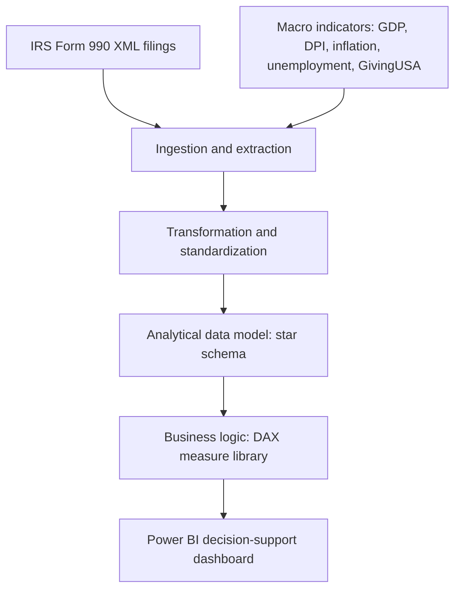

# Architecture

This document walks through how the platform is built and why it is structured the way it is. The organizing idea is that information from otherwise independent sources can be brought into one analytical environment, as long as the stages that get it there stay separate and each does one job.

## Conceptual flow

## Build stages

### 1. Requirements and problem definition

Before any tool or model, the question came first: what do stakeholders need to know, and what information answers it. Two categories of data were required. Organizational financials (revenue, contributions, fundraising expenses, program revenue, total expenses, net assets) and economic indicators (GDP, disposable personal income, inflation, unemployment, national charitable giving). The analysis had to work across four dimensions: organization, tax year, NTEE classification, and geography. The system was designed around the questions it needed to answer, not around a particular chart.

### 2. Acquisition and ingestion

Two sources with fundamentally different shapes. Form 990 filings are semi-structured XML, one document per organization, with filing periods that do not always line up. The economic indicators are annual time-series observations. The integration challenge is not loading two files. It is establishing common organizational and temporal attributes so the two can be compared downstream.

### 3. Transformation and standardization

Financial values were extracted from the XML, typed correctly, and standardized into one organizational dataset. Organizations were identified by EIN rather than name, because names vary between filings and change over time. This is entity resolution: a stable key is the foundation for reliable integration. Tax-year information was extracted and a common Year dimension introduced, since a Form 990 tax year is not automatically interchangeable with a calendar-year economic observation.

### 4. Analytical data modeling

A star schema separates measurable events from descriptive context. The fact table holds one organization filing for one tax year. Dimension tables (organization, year, NTEE sector, geography, economic indicators) provide the context those measurements are analyzed in. Because measures are defined against this model once, they stay consistent across every visual that uses them. The model and its measures are detailed in [data-model-and-measures.md](data-model-and-measures.md).

### 5. Business logic

Raw financial fields became business intelligence through a DAX measure library, grouped by the question each measure answers: fundraising efficiency, economic normalization, trend analysis, and scenario modeling. The point of putting this logic in the model rather than in individual visuals is that fundraising efficiency means the same thing whether it is read on the overview, a sector comparison, or an organizational detail table.

### 6. Presentation and decision support

A multi-page Power BI environment, not a single static report. The dashboard is the presentation layer. It consumes the model and exposes the business concepts through an interactive interface, so a user interacts with fundraising efficiency and real-dollar giving without needing to know anything about the underlying XML, transformations, or DAX.

### 7. Validation and stabilization

A stabilization pass addressed model consistency: standardizing year references to the conformed dimension, verifying relationships, hiding redundant columns, organizing measures into folders, and documenting them. Beyond cosmetics, a fuller validation would check source integrity, entity integrity, financial totals against source filings, temporal mapping, filter propagation, and the handling of nulls versus zeros. The honest findings from that review are in [limitations-and-roadmap.md](limitations-and-roadmap.md).

### 8. Extensibility

The design anticipates growth without a rebuild: more filings and tax years, more organizations, additional indicators, sector-specific analysis, and stronger forecasting. The roadmap doc lays out the evolution from a desktop analytical prototype toward a reproducible, governed data platform.

## Principles the design follows

- **Separation of concerns.** Extraction, transformation, modeling, calculation, and presentation each have distinct responsibilities.
- **Consistent definitions.** Metrics are calculated once in the model and reused, not recreated per report.
- **Stable identifiers.** EIN and a conformed Year dimension anchor reliable integration.
- **Extensibility.** The model takes on more organizations, years, and dimensions without fundamental redesign.
- **Data quality before presentation.** A polished dashboard is only as trustworthy as the model under it.
