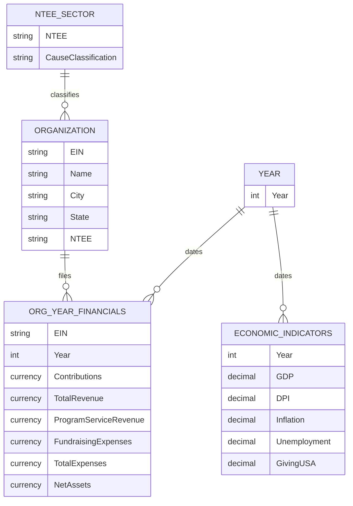

# Data Model & Measures

## Star schema

The model is organized around one fact: a single organization's financial filing for a single tax year. Descriptive context lives in dimension tables around it.



Design notes:

- **EIN is the organizational key.** Organization names vary between filings and change over time, so the Employer Identification Number is the reliable identifier for the reporting entity.
- **Year is a conformed dimension.** Both the financial fact table and the economic indicators join through one shared Year dimension, which is what allows tax-year filings and calendar-year economic observations to be compared.
- **Economic indicators are measures of a year, not descriptive attributes.** GDP, DPI, inflation, and unemployment are values associated with a year. Treating them through the conformed Year dimension keeps the model clean.

## Measure library

Measures are grouped by the question they answer. Each is defined once and reused across every visual.

### Fundraising efficiency

```dax
Fundraising Return Multiple = DIVIDE([Total Contributions], [Fundraising Expenses])

Revenue From Fundraising % = DIVIDE([Total Contributions], [Total Revenue])

AvgContributions = AVERAGE(Combined990s[Contributions])
```

The return multiple reads as contributions reported per dollar of fundraising expense. A value of 10 means ten dollars raised for every dollar spent on fundraising. It is a return multiple rather than a true ROI, because it does not subtract the fundraising expense from contributions. The dependency ratio shows how much of an organization's revenue comes from contributions versus earned program revenue.

### Economic normalization and indexing

```dax
GivingIndex =
VAR Base = CALCULATE(SUM(EconomicIndicators[GivingUSA]), EconomicIndicators[Year] = 2008)
RETURN DIVIDE(SUM(EconomicIndicators[GivingUSA]), Base) * 100

GivingToGDP = DIVIDE(SUM(EconomicIndicators[GivingUSA]), SUM(EconomicIndicators[GDP]))
GivingToDPI = DIVIDE(SUM(EconomicIndicators[GivingUSA]), SUM(EconomicIndicators[DPI]))
```

Indexing everything to a 2008 baseline of 100 lets GDP, DPI, and giving be compared as relative growth trajectories rather than as unrelated dollar amounts. Giving as a share of GDP or DPI tracks philanthropic effort over time.

Inflation-adjusted giving, as currently implemented in the model:

```dax
GivingUSA_Real =
DIVIDE('EconomicIndicators'[GivingUSA (bil $)], 1 + ('EconomicIndicators'[Inflation] / 100))

GivingUSA_RealIndex =
VAR RealGiving = DIVIDE('EconomicIndicators'[GivingUSA (bil $)], 1 + ('EconomicIndicators'[Inflation] / 100))
VAR base =
    CALCULATE(
        MAXX(
            FILTER(ALL('EconomicIndicators'), 'EconomicIndicators'[Year] = 2008),
            DIVIDE('EconomicIndicators'[GivingUSA (bil $)], 1 + ('EconomicIndicators'[Inflation] / 100))
        )
    )
RETURN DIVIDE(RealGiving, base) * 100
```

This deflates by a single year's inflation rate. For valid multi-year real-dollar comparison it should move to a cumulative price index. That refinement is tracked in [limitations-and-roadmap.md](limitations-and-roadmap.md).

### Trend and relationship analysis

```dax
FilingYear = YEAR([TaxYr])

Corr_Giving_GDP = CORREL(EconomicIndicators[GivingUSA], EconomicIndicators[GDP])

GDP_Lag1 =
CALCULATE(
    MAX(EconomicIndicators[GDP]),
    FILTER(EconomicIndicators, EconomicIndicators[Year] = EARLIER(EconomicIndicators[Year]) - 1)
)

PandemicYear = IF(EconomicIndicators[Year] IN {2020, 2021}, 1, 0)
```

Year-over-year change, correlation between giving and each economic indicator, and lagged variables to test whether last year's conditions move this year's giving. The pandemic flag isolates 2020 and 2021 so performance that deviates from economic trend can be explained rather than buried.

### Scenario modeling

```dax
ProjectedGiving =
[BaseGiving] * (1 + [GDP_Growth_Parameter]) * (1 - [Inflation_Parameter] * 0.3)
```

What-if parameters for GDP growth, inflation, and unemployment drive a projected-giving measure, so a user can explore how changes in economic assumptions move the forecast. These are exploratory assumptions, not a statistically validated model. The roadmap covers replacing them with regression estimated from history.
